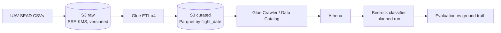

# Bina

[](https://github.com/Matanelevavi/bina/actions/workflows/ci.yml)

A telemetry pipeline on AWS over **real drone flight logs** ([UAV-SEAD](https://huggingface.co/datasets/aykutkabaoglu/uav-flight-anomaly-dataset), 1,396 labeled flights),
built as a learning and portfolio project. Three layers:

| Layer | What it does | Status |
|---|---|---|
| Batch | Glue turns ULog-derived CSVs into 4 partitioned Parquet tables, queried with Athena | Built and measured |
| AI | Bedrock (Claude Haiku) classifies the anomaly type on a stratified sample, evaluated against ground truth | Sample and evaluation code ready, classifier not yet run |
| AI orchestration | An agent monitors pipeline health, a second agent analyzes the first one's mistakes | Planned |

## Architecture


## What is verified
- 4 Glue jobs SUCCEEDED, 151 / 151 / 151 / 23 partitions by `flight_date`.
- Athena scans **72,996 bytes on Parquet vs 1,492,495 bytes on CSV** for the same 46 flights (about 20.4x less). One run each, small sample, see [docs/measurements.md](docs/measurements.md).
- Security: two customer-managed KMS keys, S3 versioning, CloudTrail data events on the data buckets only, a read-only Athena role with MFA-gated assume-role.
- Total spend so far about $6 of credits, see [docs/measurements.md](docs/measurements.md).

## Known limitations (stated up front)
- **110 flights (8.8%) are silently skipped** by the Glue glob because they sit in `date/sessNNN/logNNN/` paths. Fix is deferred. See [docs/architecture.md](docs/architecture.md).
- The evaluation sample is **50 flights**, so per-class precision/recall are small-sample estimates.
- **GPS presence leaks the label** in this dataset (Global Position always has GPS, Altitude never). The evaluation controls for it, see [docs/evaluation-design.md](docs/evaluation-design.md).
- Infrastructure was created through the console and CLI. Terraform is planned, not done.

## Repository layout
```
src/bina/      paths (raw key rules), sqlgen (Athena SQL), sampling, features (per-flight stats and prompt), metrics
scripts/       make_verification_sql.py
data/          sample.json, the 50-flight evaluation sample (seed 42)
docs/          architecture, evaluation design, measurements
tests/         pytest suite, run in CI
```

## Run the tests
```bash
pip install -e ".[dev]"
pytest -q
```

Note: `sampling.stratified_sample` is a clean reimplementation. It is **not** guaranteed to reproduce `data/sample.json` exactly,
which was produced by an earlier CloudShell script. The committed file is the source of truth, and a test checks its structure.

## Data
The raw dataset is not stored here. Download it from Hugging Face. CSV, ULog and Parquet files are git-ignored on purpose.
